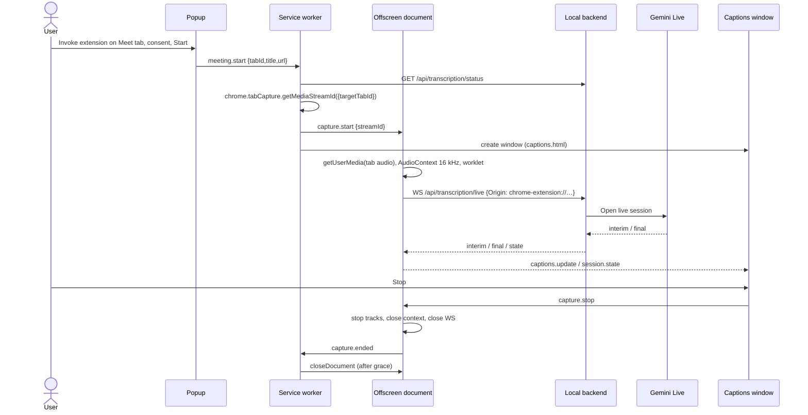

# SignBridge Extension: architecture

Status: Day 1–2 signing features and Phase 1 meeting captions implemented. Meeting captions are **experimental** and
have not been verified with a real Google Meet call. No AI model, backend endpoint or recognition rule was changed.

## 1. Components

```
Chrome or Edge (Manifest V3)
  Popup (popup.html, React)
    src/popup/App.jsx             Live / Message / Meet tabs
    src/popup/useRecognition.js   Camera status, 200 ms polling (Day 1–2)
    src/popup/useComposer.js      Stable-letter composer (Day 2)
    src/popup/MeetPanel.jsx       Consent + start/stop meeting captions
    src/lib/apiClient.js          Backend HTTP client (Day 1–2)

  Background service worker (src/background.js)
    - receives the user's start/stop intent
    - checks /api/transcription/status
    - obtains the tab-capture stream ID after invocation
    - creates the offscreen document and the captions window
    - stops capture when the window or captured tab closes
    - holds no audio and no transcript text

  Offscreen document (offscreen.html, src/offscreen/)
    - owns the tab MediaStream, AudioContext, AudioWorklet, PCM and WebSocket
    - owns the in-memory transcript
    - broadcasts state and caption updates to the captions window

  Captions window (captions.html, src/captions/, React)
    - renders the persistent capture banner, interim/final captions and errors
    - Stop / Clear text / Larger text / Close window
    - a pure renderer; the offscreen document is authoritative

                │ HTTP (host_permissions) and WebSocket (pinned Origin)
                ▼
Local SignBridge backend (127.0.0.1:8000, unchanged)
  Camera + MediaPipe + alphabet/phrase/sequence recognisers   (signing)
  /api/transcription/live → Gemini Live                        (captions)
```

There is no content script and no Meet DOM injection. The captions window is a separate window, chosen over Document
Picture-in-Picture for Phase 1.

## 2. Signing contract (unchanged)

| Call | Used for |
| --- | --- |
| `GET /api/health` | Reachability |
| `GET /api/camera/status` | Initial state |
| `POST /api/camera/start` / `stop` | Recognition camera |
| `GET /api/recognition/latest` | Polled every 200 ms while running |
| `GET /api/camera/stream` | Backend MJPEG preview |

Recognition display rules are unchanged: a letter is shown only for `recognized` with a single A–Z label, every result
carries the experimental label, and `uncertain`, `no_hand`, `two_hands`, `camera_off` and `no_model` never show a
letter. The camera belongs to the backend; the extension never calls `getUserMedia` for video.

## 3. Meeting captions pipeline



### 3.1 Audio format

- Tab stream is typically 48 kHz stereo.
- The offscreen document requests `new AudioContext({ sampleRate: 16000 })`; Chrome resamples the tab source.
- The AudioWorkletNode uses `channelCount: 1`, `channelCountMode: 'explicit'`, so stereo is downmixed.
- A clean-room windowed-sinc resampler handles the fallback when Chrome ignores the requested rate.
- PCM is 16 kHz mono signed 16-bit little-endian, 100 ms (1 600 samples, 3 200 bytes) per frame, below the backend's
  32 000-byte limit.
- Audio is queued only while the WebSocket is connecting and is **not sent before the backend's `ready` message**.
  The queue is capped at 10 frames; excess frames are dropped and counted.

### 3.2 Wire protocol

Browser → backend:

```json
{"type":"start","encoding":"pcm_s16le","sampleRate":16000,"channels":1,"language":"auto","seqStart":1}
{"type":"stop"}
{"type":"ping"}
```

Binary frames are PCM. Backend → browser: `ready`, `state`, `interim`, `final`, `error`, `pong`, `closed`.

Transport behaviour:

- one socket at a time; start message on open;
- ping every 15 s, pong timeout 5 s;
- reconnect with 0.5, 1, 2, 4, 8 s backoff after a recoverable drop;
- a fatal close (1008/1009) or a non-recoverable backend error fails the session;
- a 1006 close before the socket ever opened is treated as a rejected handshake (usually the CORS/Origin check);
- `seqStart` after reconnect continues from the last confirmed final.

## 4. Runtime message contract

Every message names its receiver. Broadcast delivery through `chrome.runtime` cannot create loops because listeners
filter on `target`.

| Type | From → To | Purpose |
| --- | --- | --- |
| `meeting.start` | popup → worker | Start for a tab (after consent) |
| `meeting.stop` | popup/captions → worker | Stop and clean up |
| `meeting.status` | popup → worker | Is a session active? |
| `capture.start` | worker → offscreen | Stream ID + tab identity |
| `capture.stop` | worker/captions → offscreen | Stop immediately |
| `capture.ended` | offscreen → worker | Close the offscreen document |
| `session.state` | offscreen/worker → captions | Phase, error, tab, dropped frames |
| `captions.update` | offscreen → captions | Interim/final transcript |
| `captions.clear` | captions → offscreen | Clear visible text only |
| `session.snapshot` | captions/worker → offscreen | Late-join snapshot |
| `captions.ready` | captions → worker | Window ID for close handling |

## 5. Lifecycle rules

- **Start** requires an explicit user invocation and consent. Startup runs as a bounded transaction with these stages:
  `stream_id → backend → offscreen → captions_window → capture_start`. Each has its own timeout and safe reason
  (`stream_id_timeout`, `backend_down`, `offscreen_failed`, `window_create_failed`, `capture_timeout`, …).
- **Start diagnostics** are stored in service-worker memory and exposed through `meeting.diagnostics` as
  `{stage, reason, detail, ok, at}`. The popup shows the category and appends the technical detail. The worker logs one
  `[SignBridge startup]` line with no audio, transcript, tab title or meeting URL.
- **Failure cleanup** closes the captions window created by that attempt, stops/closes the offscreen document, clears
  the session and resets `starting`, so a retry works without restarting Chrome. A reused pre-existing captions window
  is kept open and told that startup failed.
- **Idempotent Start** — if a session is active or already starting, the worker focuses the existing window and
  returns `{ok:true, alreadyRunning:true}` instead of creating a second capture or window.
- **The popup is not the runtime.** Capture continues after it closes because it lives in the offscreen document.
- **Stop** is immediate: tracks are stopped first, then the AudioContext/worklet are closed and the WebSocket is
  closed. The offscreen document is closed by the service worker after a short grace period.
- **Captions window close** triggers `chrome.windows.onRemoved` in the service worker and stops capture. The window also
  sends a best-effort stop on `pagehide`.
- **Captured tab close** is handled by the track's `ended` event and by `chrome.tabs.onRemoved`.
- **A 30-minute client limit** stops the session before the backend's 30-minute connection cap.
- The transcript is cleared when the offscreen document closes. It is never persisted.

## 6. Permissions and security

| Permission | Justification |
| --- | --- |
| `activeTab` | Only the tab the user invokes is captured; no persistent website access |
| `scripting` | Day 2 explicit Insert into page action only |
| `storage` | `chrome.storage.session` for the composed message only |
| `tabCapture` | Audio of the user-selected tab; no microphone |
| `offscreen` | DOM/audio/WebSocket context for capture and transcription |

- `host_permissions`: `http://127.0.0.1:8000/*` only. No `<all_urls>`, no Meet host permission, no `tabs`.
- No content scripts, no injected overlay, no remote code. The build emits no inline scripts.
- No API keys are stored in the extension. Gemini stays behind the backend.
- Transcript text is rendered by React as text, never `innerHTML`.
- The service worker does not log audio or transcripts; the offscreen document does not log either.

### 6.1 Pinned extension ID

`public/manifest.json` contains a public `key`. The extension ID is derived from it:

```
chrome-extension://hfccobalkbgnibbjlmjmpjkffleccace
```

The backend `.env` allow-list contains exactly that origin; no wildcard. The matching private key is not committed and
is only needed for packaging/signing. If the `key` changes:

1. compute the new ID;
2. update `SIGNBRIDGE_CORS_ORIGINS` in `backend/.env`;
3. restart the backend;
4. update the manifest test and this document.

## 7. Camera policy

The backend owns the webcam. Google Meet also needs the same device when its camera is on. Phase 0 measured that:

- Meet-style Chrome capture first → the backend starts but receives black frames;
- backend first → Chrome fails with `NotReadableError: Device in use`.

Therefore the MVP policy is: **Google Meet camera OFF while SignBridge camera is ON**. The extension never opens a
second camera session and never tries to share Meet's stream.

Meeting captions use audio only and do not conflict with the camera.

## 8. Build and tests

Multi-entry Vite build:

- `popup.html`, `captions.html`, `offscreen.html` (HTML pages);
- `src/background.js` → `dist/background.js` (module service worker);
- `src/offscreen/worklet.js` → `dist/worklet.js` (classic AudioWorklet script);
- React/UI code is hashed under `dist/assets/`.

Tests (Vitest + jsdom) cover the manifest/permissions/pinned ID, Day 1–2 behaviour, PCM, protocol, transport,
caption state, the popup panel and the captions window. The manual Meet matrix is in
`docs/MEETING_MODE_TEST_MATRIX.md`.

## 9. Known limits

- Single fingerspelled letters only; the model is unverified.
- Meeting captions have not been tested with Google Meet or real remote participant audio.
- The backend must run locally; captions require Gemini access.
- Audio comes only from the selected tab. Tab mute does not silence capture, so the visible indicator is essential.
- No chat insertion, no overlay, no PiP in Phase 1.
- The transcript is in memory only and ends with the session.
- The camera cannot be shared usefully with Meet; Meet video stays off during signing.
